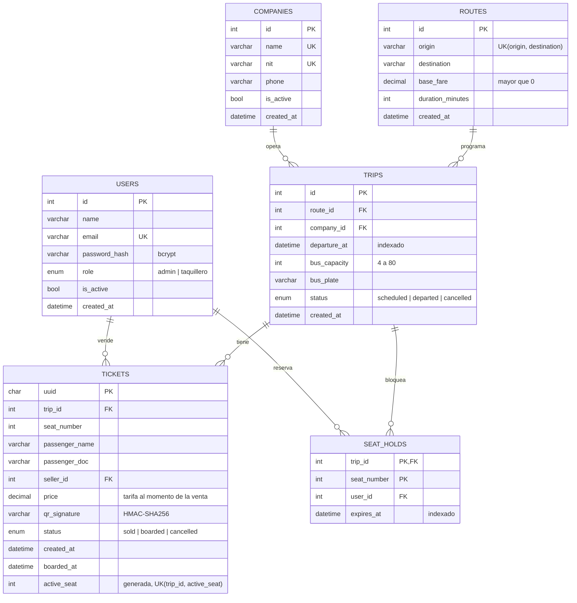

# Modelo de datos (diagrama entidad-relación)

Base de datos MySQL 8 con motor InnoDB (transacciones y claves foráneas). La fuente es
[`database/schema.sql`](../database/schema.sql).

## Entidades

| Tabla | Qué guarda | Reglas importantes |
|---|---|---|
| `users` | Personal de la terminal (administradores y taquilleros) | Email único. La contraseña solo se guarda como hash bcrypt. `is_active = false` bloquea el ingreso sin borrar el historial de ventas. |
| `companies` | Empresas transportadoras | Nombre y NIT únicos. |
| `routes` | Trayecto origen → destino con su tarifa (RF02) | Un solo registro por par origen-destino. La tarifa debe ser mayor que 0 y el origen distinto del destino (`CHECK`). |
| `trips` | Salida concreta: ruta + empresa + fecha/hora + bus | Capacidad entre 4 y 80 asientos. Índice por `departure_at` para la búsqueda por fecha. |
| `tickets` | Tiquete vendido a un pasajero | La clave es un UUID, así que no se puede adivinar ni recorrer. `price` copia la tarifa vigente al vender, y por eso cambiar la tarifa no altera los tiquetes ya vendidos. |
| `seat_holds` | Reserva temporal de un asiento mientras se registra al pasajero (HU03) | Clave `(trip_id, seat_number)`: un asiento solo puede tener una reserva. Vence en `expires_at` (2 minutos). Se borra en cascada si se elimina el viaje. |

## Cardinalidades

- Una **empresa** opera muchos **viajes**, y cada viaje pertenece a una empresa.
- Una **ruta** se programa en muchos **viajes**, y cada viaje usa una ruta.
- Un **viaje** tiene muchos **tiquetes**: como máximo uno activo por asiento.
- Un **usuario** (taquillero o administrador) vende muchos **tiquetes**, y cada tiquete registra quién lo vendió (`seller_id`). Con eso se arma el reporte de recaudo por taquillero.
- Un **viaje** tiene muchas **reservas temporales**, una por asiento. Un usuario tiene como máximo una reserva activa por viaje; esa regla la aplica la API.

## Restricción contra la venta doble (RNF01)

`active_seat` es una **columna generada**. Su valor es `seat_number` cuando el tiquete está vendido o abordado,
y `NULL` cuando está anulado. El índice único `UNIQUE(trip_id, active_seat)` impide que existan dos tiquetes
**activos** en el mismo asiento. Como MySQL permite varios `NULL` en un índice único, un asiento anulado se puede
vender de nuevo.

Esta restricción es la red de seguridad de la base de datos. La protección principal es el bloqueo
`SELECT ... FOR UPDATE` sobre la fila del viaje, que se describe en el [manual técnico](manual-tecnico.md#4-decisiones-técnicas-críticas).
