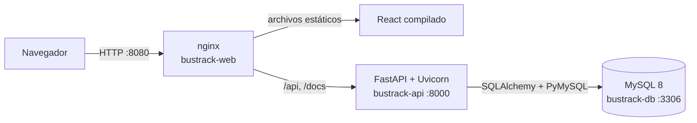

# BusTrack · Manual técnico

**Versión:** 1.0.0 · **Asignatura:** Proyecto Integrador 1 (Univalle) · **Autor:** Kevin Castillo

Este documento explica cómo está construido BusTrack, por qué se tomaron las decisiones principales y cómo
instalarlo, configurarlo, probarlo y mantenerlo.

## Contenido

1. [Objetivo y alcance](#1-objetivo-y-alcance)
2. [Arquitectura](#2-arquitectura)
3. [Estructura del código](#3-estructura-del-código)
4. [Decisiones técnicas críticas](#4-decisiones-técnicas-críticas)
5. [API REST](#5-api-rest)
6. [Modelo de datos](#6-modelo-de-datos)
7. [Seguridad](#7-seguridad)
8. [Instalación y despliegue](#8-instalación-y-despliegue)
9. [Configuración](#9-configuración)
10. [Pruebas e integración continua](#10-pruebas-e-integración-continua)
11. [Flujo de trabajo con Git](#11-flujo-de-trabajo-con-git)
12. [Mantenimiento y operación](#12-mantenimiento-y-operación)
13. [Trazabilidad de requisitos](#13-trazabilidad-de-requisitos)

---

## 1. Objetivo y alcance

BusTrack digitaliza la operación de una terminal de transporte terrestre intermunicipal:

- **Público:** consulta de horarios, tarifas y asientos disponibles sin necesidad de iniciar sesión.
- **Taquilla:** búsqueda de viajes, grilla de asientos en vivo, reserva temporal del asiento, venta y tiquete con código QR.
- **Control de abordaje:** verificación del QR con cámara, lector o código pegado. Cada tiquete sirve para un solo abordaje.
- **Administración:** empresas, rutas y tarifas, programación de viajes, usuarios, anulación de tiquetes y reportes
  diarios de ocupación y recaudo (por empresa y por taquillero), exportables a CSV.

Fuera de alcance en la versión 1.0: pagos en línea, venta por internet al pasajero final y facturación electrónica.

## 2. Arquitectura

Es una aplicación web de tres capas, cada una en su propio contenedor Docker:



| Capa | Tecnología | Responsabilidad |
|---|---|---|
| Presentación | React 18, Vite, Tailwind CSS v4, React Router, lucide-react, html5-qrcode | Interfaz por rol, validaciones de formulario, grilla que se actualiza sola, escaneo de QR |
| Servidor web | nginx 1.27 | Sirve el frontend compilado y reenvía `/api` y `/docs` a la API (proxy inverso). Así el navegador solo habla con un origen y no hay problemas de CORS. |
| Lógica de negocio | Python 3.13, FastAPI, Pydantic v2, SQLAlchemy 2 | Endpoints REST, reglas de negocio, autenticación JWT, roles, transacciones |
| Datos | MySQL 8 (InnoDB) | Persistencia, integridad referencial, restricciones únicas y `CHECK` |

**Por qué este stack.** FastAPI genera la documentación Swagger automáticamente y valida las entradas con
Pydantic. SQLAlchemy permite bloqueos de fila (`with_for_update`), necesarios para la venta concurrente. React con
Vite compila rápido y deja una aplicación estática que nginx sirve sin necesidad de Node en producción. MySQL es la
base de datos definida en la planeación del proyecto.

**Orden de arranque.** Cada servicio tiene un *healthcheck* y `depends_on: condition: service_healthy`, así que el
arranque es MySQL listo → API lista → web. Al iniciar, la API ejecuta `app/startup.py`, que espera a la base de
datos (hasta 90 s) y carga los datos de demostración **solo si la base está vacía**.

## 3. Estructura del código

```
bustrack/
├── docker-compose.yml          Orquestación: db + api + web
├── database/
│   ├── schema.sql              Esquema MySQL (se aplica al crear el volumen)
│   ├── test-db.sql             Crea la base aislada bustrack_test para las pruebas
│   └── migrations/             Cambios incrementales para bases existentes
├── backend/
│   ├── Dockerfile              python:3.13-slim, usuario sin privilegios
│   ├── app/
│   │   ├── main.py             App FastAPI, middleware, manejadores de error, routers
│   │   ├── config.py           Variables de entorno y validación de secretos
│   │   ├── database.py         Motor SQLAlchemy y sesión por petición
│   │   ├── models.py           Entidades ORM
│   │   ├── schemas.py          DTOs de entrada/salida y validaciones (Pydantic)
│   │   ├── security.py         bcrypt, JWT y dependencias de rol
│   │   ├── qr.py               Firma HMAC y generación de imagen QR
│   │   ├── rate_limit.py       Límite de intentos de inicio de sesión
│   │   ├── clock.py            Hora oficial de la terminal (America/Bogota)
│   │   ├── services.py         Serialización y utilidades compartidas
│   │   ├── logging_config.py   Registro de eventos (sin datos personales)
│   │   ├── startup.py          Espera de BD y datos demo al arrancar
│   │   ├── seed.py             Datos de demostración
│   │   └── routers/            auth, catalog, trips, holds, tickets, reports
│   └── tests/
│       ├── unit/               Pruebas sin base de datos
│       └── integration/        Pruebas de la API contra MySQL
├── frontend/
│   ├── Dockerfile              Compilación con Node 22 → nginx
│   ├── nginx.conf              Proxy /api y /docs, caché de assets, rutas SPA
│   └── src/
│       ├── lib/                Cliente API, sesión, formatos, CSV
│       ├── components/         Layout, SeatGrid, TripSearch, CrudPage, TicketModal, QrScanner, ErrorBoundary
│       └── pages/              PublicSchedule, Login, Taquilla, Tickets, Verify, admin/*
└── .github/workflows/ci.yml    Integración continua
```

## 4. Decisiones técnicas críticas

### 4.1 Sin venta doble del mismo asiento (RNF01)

Dos taquillas pueden intentar vender el mismo asiento en el mismo instante. Para evitarlo hay tres capas:

1. **Bloqueo pesimista del viaje.** La venta empieza con `SELECT ... FROM trips WHERE id = ? FOR UPDATE`. Las ventas
   y reservas de un mismo viaje quedan en fila: la segunda espera a que la primera confirme (`COMMIT`). Las ventas de
   viajes distintos no se bloquean entre sí.
2. **Nueva comprobación dentro de la transacción.** Con el viaje ya bloqueado, se busca un tiquete activo para ese
   asiento (también con `FOR UPDATE`). Si existe, la venta responde **409 Conflict** con un mensaje claro.
3. **Restricción en la base de datos.** `UNIQUE(trip_id, active_seat)`, donde `active_seat` es una columna generada
   que vale `NULL` cuando el tiquete está anulado. Aunque hubiera un error en el código, MySQL rechaza el segundo
   tiquete. Ese `IntegrityError` se convierte en 409.

El nivel de aislamiento es `READ COMMITTED`, para que la nueva comprobación vea lo que la venta anterior ya confirmó.
La prueba `test_tickets.py` lanza ventas simultáneas con hilos y comprueba que solo una tiene éxito.
`tests/concurrency_test.py` repite la demostración contra el servidor en vivo (por ejemplo, 20 ventas simultáneas
dan 1 éxito y 19 respuestas 409).

### 4.2 Reserva temporal del asiento (HU03)

Al hacer clic en un asiento, la taquilla llama a `POST /api/trips/{id}/holds`, que reserva el asiento durante
**2 minutos** (`SEAT_HOLD_SECONDS`) mientras se digitan los datos del pasajero.

- Las demás taquillas ven el asiento como **reservado** y no lo pueden vender (409).
- Cada taquillero tiene como máximo una reserva por viaje: si elige otro asiento, la anterior se libera.
- La reserva se consume con la venta, se libera al deseleccionar el asiento y vence sola. Las vencidas se purgan en
  la siguiente operación sobre ese viaje.
- La reserva usa el mismo bloqueo del viaje que la venta, así que reservar y vender no se pueden cruzar.

### 4.3 Código QR no adivinable ni falsificable (RNF02)

- El contenido del QR es `uuid.firma`.
  - El `uuid` es aleatorio (UUID v4, 122 bits), así que no se puede adivinar ni recorrer en secuencia.
  - La `firma` es `HMAC-SHA256(QR_SECRET, "uuid|trip_id|asiento")`, truncada a 32 caracteres hexadecimales (128 bits).
- Al verificar, el sistema recalcula la firma y la compara en tiempo constante (`hmac.compare_digest`). Así detecta
  códigos alterados, inventados, copiados de otro viaje o con el asiento cambiado.
- Verificación en dos pasos:
  - `GET /verify` solo consulta.
  - `POST /verify` registra el abordaje y bloquea la fila del tiquete. Por eso dos lectores no pueden aceptar el
    mismo QR a la vez.
- Un tiquete abordado o anulado se rechaza con un mensaje que indica el motivo (incluida la fecha y hora del abordaje).

### 4.4 Hora oficial de la terminal

Los servidores en la nube y los contenedores trabajan en UTC, mientras que la terminal opera en hora de Colombia.
Todo el código usa `app.clock.now()` y `today()`, que devuelven la hora de `APP_TIMEZONE` (por defecto
`America/Bogota`). De eso dependen la búsqueda de viajes, el vencimiento de reservas, el bloqueo de ventas de viajes
que ya salieron y los reportes por día. Las pruebas corren tanto en Windows como en el contenedor (UTC), lo que
garantiza que el resultado no depende de la zona horaria del servidor.

### 4.5 Tarifa congelada en el tiquete

`tickets.price` copia la tarifa de la ruta en el momento de la venta. Si después cambia la tarifa, los tiquetes ya
vendidos y los reportes de recaudo históricos no se alteran.

### 4.6 Borrado seguro

- No se pueden eliminar empresas ni rutas que tengan viajes, ni viajes con tiquetes vendidos. En esos casos el sistema
  responde 409 y explica la alternativa: desactivar la empresa o marcar el viaje como cancelado.
- Los usuarios se desactivan en lugar de borrarse, para conservar quién vendió cada tiquete.

## 5. API REST

La documentación interactiva (Swagger) está en `http://localhost:8080/docs`. Todas las rutas llevan el prefijo `/api`.
Los roles son *Público* (sin token), *Staff* (administrador o taquillero) y *Admin*.

| Método | Ruta | Rol | Descripción |
|---|---|---|---|
| POST | `/auth/login` | Público | Inicia sesión y devuelve el JWT. Bloquea tras 5 intentos fallidos (429). |
| GET | `/auth/me` | Staff | Datos del usuario autenticado |
| GET · POST · PUT | `/users`, `/users/{id}` | Admin | Gestión de usuarios (crear, editar, activar o desactivar) |
| GET | `/trips/cities` | Público | Orígenes y destinos disponibles |
| GET | `/trips/search?origin=&destination=&date=` | Público | Viajes programados con asientos disponibles (HU01) |
| GET | `/trips/{id}/seats` | Público | Estado de cada asiento: `free`, `reserved`, `sold`, `boarded` |
| GET | `/trips/today` · `/trips?date=` | Staff | Viajes del día o de una fecha |
| POST · PUT · DELETE | `/trips`, `/trips/{id}` | Admin | Programación de viajes |
| POST | `/trips/{id}/holds` | Staff | Reserva temporal de un asiento (2 min) |
| DELETE | `/trips/{id}/holds/{asiento}` | Staff | Libera la reserva propia |
| POST | `/tickets` | Staff | Vende un tiquete: 201 con el QR, o 409 si el asiento está vendido o reservado |
| GET | `/tickets?trip_id=` · `/tickets?date=` | Staff | Tiquetes de un viaje o de un día |
| GET | `/tickets/search?q=` | Staff | Busca por documento o nombre (mínimo 3 caracteres) |
| GET | `/tickets/{uuid}` | Staff | Tiquete con imagen QR (reimpresión) |
| GET | `/tickets/verify?code=` | Staff | Consulta la validez sin registrar abordaje |
| POST | `/tickets/verify` | Staff | Valida y registra el abordaje (un solo uso) |
| POST | `/tickets/{uuid}/cancel` | Admin | Anula un tiquete no abordado y libera el asiento |
| GET · POST · PUT · DELETE | `/companies`, `/routes` | Staff lee, Admin escribe | Empresas y rutas con tarifas (HU02) |
| GET | `/reports/daily?date=` | Admin | Viajes, ocupación y recaudo por empresa y por taquillero (HU05) |
| GET | `/health` | Público | Estado del servicio (usado por el *healthcheck*) |

**Códigos de respuesta usados:**

| Código | Significado |
|---|---|
| 200 / 201 / 204 | Éxito |
| 401 | Sin token o token vencido |
| 403 | El rol no tiene permiso |
| 404 | El recurso no existe |
| 409 | Conflicto de negocio: asiento ocupado, viaje que ya salió, borrado con dependencias |
| 422 | Datos inválidos, con mensajes en español |
| 429 | Demasiados intentos de inicio de sesión (con cabecera `Retry-After`) |
| 500 | Error inesperado. Se registra en el log y no expone detalles internos. |

## 6. Modelo de datos

Seis tablas: `users`, `companies`, `routes`, `trips`, `tickets` y `seat_holds`. El diagrama entidad-relación, las
cardinalidades y las restricciones están en [diagrama-er.md](diagrama-er.md).

## 7. Seguridad

| Aspecto | Implementación |
|---|---|
| Contraseñas | Hash **bcrypt** con sal. Nunca se guardan ni se registran en texto plano. |
| Autenticación | **JWT** firmado (HS256). Expira a las 8 horas (`JWT_EXPIRE_MINUTES`). Ante un 401, el frontend cierra la sesión. |
| Autorización | Cada endpoint declara su rol con dependencias de FastAPI (`staff`, `admin_only`). El frontend además oculta las rutas, pero la seguridad real está en la API. |
| Usuarios inactivos | No pueden iniciar sesión, y un token emitido antes de la desactivación deja de servir. |
| Fuerza bruta | 5 intentos fallidos por combinación correo + IP dentro de 5 minutos → 429 con `Retry-After`. |
| Secretos | `JWT_SECRET` y `QR_SECRET` deben tener al menos 32 bytes. Con `APP_ENV=production` la API **no arranca** si se usan los valores de desarrollo. El archivo `.env` está excluido de Git. |
| Inyección SQL | Todas las consultas usan SQLAlchemy con parámetros enlazados. |
| Validación | Pydantic valida tipos, longitudes y formatos. Por ejemplo, el nombre del pasajero solo admite letras, espacios y signos de nombre, y el documento admite de 5 a 20 letras, números o guiones. |
| Cabeceras HTTP | `X-Content-Type-Options: nosniff`, `X-Frame-Options: DENY`, `Referrer-Policy`. |
| Errores | El manejador global devuelve un mensaje genérico. El detalle técnico solo queda en el log del servidor. |
| Registro (logs) | Se registran ventas, anulaciones, abordajes, QR rechazados e inicios de sesión fallidos. Solo se guardan identificadores, nunca nombres, documentos ni contraseñas. |
| Contenedores | La API corre con un usuario sin privilegios (uid 1000) y no expone su puerto al host: solo se llega a ella a través de nginx. |

## 8. Instalación y despliegue

### 8.1 Despliegue completo con Docker (recomendado)

Requisitos: Docker Desktop (o Docker Engine con Compose v2) y los puertos 8080 y 3307 libres.

```bash
git clone https://github.com/ashlyalex13/BusTrack.git
cd BusTrack
docker compose up --build
```

- Aplicación: http://localhost:8080
- Documentación de la API: http://localhost:8080/docs
- Usuarios de demostración: `admin@bustrack.co / admin123`, `taquilla1@bustrack.co / taquilla123`, `taquilla2@bustrack.co / taquilla123`

| Comando | Efecto |
|---|---|
| `docker compose up -d --build` | Arranca en segundo plano |
| `docker compose ps` | Estado y salud de los contenedores |
| `docker compose logs -f api` | Registro de la API |
| `docker compose down` | Detiene el sistema y **conserva** los datos |
| `docker compose down -v` | Detiene el sistema y **borra** la base de datos |

### 8.2 Entorno de desarrollo

En este modo la base de datos corre en Docker, y el backend y el frontend corren en la máquina local con recarga
automática. Los pasos están en el [README](../README.md#ejecución-para-desarrollo-sin-contenedores-para-la-app).
Vite reenvía `/api` al backend en el puerto 8000.

### 8.3 Despliegue en un servidor

1. Crear un archivo `.env` junto a `docker-compose.yml` con:

   ```
   APP_ENV=production
   JWT_SECRET=<aleatorio de 48+ caracteres>
   QR_SECRET=<otro aleatorio de 48+ caracteres>
   MYSQL_PASSWORD=<contraseña segura>
   SEED_DEMO=false
   ```

   Cada secreto se puede generar con `python -c "import secrets; print(secrets.token_urlsafe(48))"`.
2. Ejecutar `docker compose up -d --build`.
3. Poner un proxy con HTTPS delante del puerto 8080 (por ejemplo Caddy o el balanceador del proveedor) y ajustar
   `CORS_ORIGINS` al dominio real.
4. Crear el primer administrador con `python -m app.seed` (solo en un entorno de prueba, porque borra los datos) o
   directamente en la base de datos.

## 9. Configuración

Variables de entorno de la API. En Docker se definen en `docker-compose.yml` o en `.env`; en desarrollo, en `backend/.env`.

| Variable | Por defecto | Descripción |
|---|---|---|
| `APP_ENV` | `development` | Con `production` se exigen secretos propios |
| `DATABASE_URL` | MySQL local en el puerto 3307 | Cadena de conexión SQLAlchemy |
| `JWT_SECRET` | valor de desarrollo | Firma de los tokens (mínimo 32 bytes) |
| `QR_SECRET` | valor de desarrollo | Firma de los QR. Cambiarlo invalida los tiquetes emitidos. |
| `JWT_EXPIRE_MINUTES` | `480` | Duración de la sesión |
| `APP_TIMEZONE` | `America/Bogota` | Zona horaria de la terminal |
| `SEAT_HOLD_SECONDS` | `120` | Duración de la reserva de asiento |
| `LOGIN_MAX_ATTEMPTS` / `LOGIN_LOCK_SECONDS` | `5` / `300` | Límite de intentos de inicio de sesión |
| `CORS_ORIGINS` | `http://localhost:5173` | Orígenes permitidos, separados por coma |
| `SEED_DEMO` | `true` en Docker | Carga datos demo si la base está vacía |
| `MYSQL_PASSWORD` | `bustrack` | Contraseña del usuario de la base de datos en Docker |

## 10. Pruebas e integración continua

| Capa | Tipo | Herramienta | Cantidad | Qué cubre |
|---|---|---|---|---|
| Backend | Unitarias | pytest | 51 | Firma HMAC y QR, contraseñas, JWT y roles, validaciones, servicios, límite de login, secretos y hora |
| Backend | Integración | pytest + MySQL | 134 | API completa: venta concurrente, reservas, QR, permisos, CRUD, reportes, logs y arranque |
| Frontend | Componentes y flujos | Vitest + Testing Library | 43 | Formatos, CSV, cliente API, grilla de asientos y flujos de taquilla, verificación, login y portal |

- **Cobertura:** 97 % del backend. En el frontend, los módulos principales están entre 85 % y 100 %.
- **Aislamiento:** las pruebas de integración usan la base `bustrack_test`, que se recrea al iniciar la sesión de
  pruebas. Así nunca tocan los datos de la aplicación.
- **GitHub Actions** (`.github/workflows/ci.yml`) corre en cada push y Pull Request con tres trabajos:
  1. backend, con un servicio MySQL 8;
  2. frontend: pruebas, cobertura y compilación;
  3. Docker: levanta el sistema completo, lo consulta a través de nginx y ejecuta las pruebas dentro del contenedor.
     Este trabajo solo corre si los dos anteriores pasan.

Los comandos para ejecutar las pruebas están en la [guía de pruebas](guia-pruebas.md#2-pruebas-automatizadas).

## 11. Flujo de trabajo con Git

- `main` contiene solo versiones publicadas, cada una con su etiqueta (`v1.0.0`).
- `develop` es la rama de integración.
- `feature/*` es una rama por bloque de trabajo. Cada una entra a `develop` mediante un Pull Request, y solo se
  fusiona cuando la integración continua está en verde.
- Los mensajes de commit usan prefijos convencionales: `feat:`, `fix:`, `test:`, `docs:`, `ci:`.

## 12. Mantenimiento y operación

- **Respaldo de la base de datos:**

  ```bash
  docker exec bustrack-db mysqldump -ubustrack -pbustrack bustrack > respaldo.sql
  ```

  **Restauración:**

  ```bash
  docker exec -i bustrack-db mysql -ubustrack -pbustrack bustrack < respaldo.sql
  ```
- **Cambios de esquema en una base existente:** `schema.sql` solo se aplica cuando se crea un volumen nuevo. Para una
  base que ya existe, aplicar los scripts de `database/migrations/`. Por ejemplo:

  ```bash
  docker exec -i bustrack-db mysql -uroot -proot bustrack < database/migrations/001_seat_holds.sql
  ```
- **Registros:** `docker compose logs api` muestra las ventas, anulaciones, abordajes y rechazos.
- **Restablecer los datos de demostración:**

  ```bash
  docker compose exec api python -m app.seed
  ```

  Esto **borra** todos los datos.

## 13. Trazabilidad de requisitos

| Requisito | Implementación | Prueba automatizada |
|---|---|---|
| HU01 Consulta pública de horarios | `GET /trips/search`, página `PublicSchedule` | `test_tickets.py`, `PublicSchedule.test.jsx` |
| HU02 Rutas y tarifas | `/routes`, página `RoutesAdmin` | `test_crud.py`, `CrudPage.test.jsx` |
| HU03 Venta con grilla y reserva | `POST /tickets`, `/holds`, página `Taquilla` | `test_tickets.py`, `test_holds.py`, `Taquilla.test.jsx` |
| HU04 Verificación de QR | `/tickets/verify`, página `Verify` | `test_qr.py`, `unit/test_qr.py`, `Verify.test.jsx` |
| HU05 Reporte diario | `GET /reports/daily`, página `Dashboard` | `test_admin.py` |
| RNF01 Sin venta doble | `FOR UPDATE` + `UNIQUE(trip_id, active_seat)` | `test_tickets.py` (concurrencia), `concurrency_test.py` |
| RNF02 QR seguro | HMAC-SHA256 + UUID v4 | `test_qr.py`, `unit/test_qr.py` |
| RNF03 Seguridad y roles | bcrypt, JWT, `require_roles`, límite de login | `test_auth.py`, `test_security.py`, `unit/test_security.py` |
